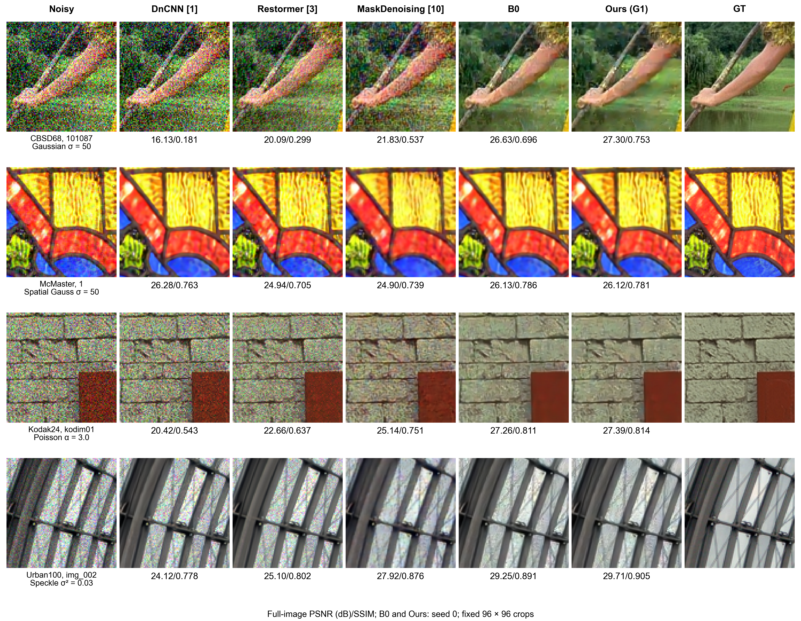

# 外部去噪方法定性对比图

已完成 DnCNN、Restormer、MaskDenoising 三种方法在既有四个示例上的真实推理，共 12 张新输出。HAT、DIL 尚缺可用预训练权重，因此当前图没有这两列，五种外部方法尚未全部补齐。本次没有训练任何模型；此前暂停的 Figure 8 训练任务保持暂停。



## 交付内容

- `figures/comparison_available_methods.png`：600 dpi 总图。
- `figures/comparison_available_methods.pdf`、`.svg`：文字可编辑的版本。
- `figures/comparison_row1.png` 至 `comparison_row4.png`：逐行图片。
- `figures/comparison_metrics.csv`：单图指标源数据。
- `figures/comparison_caption.txt`：英文图注。
- `inference/<方法>/row*/`：完整恢复图、局部放大图和指标；浮点输出保留在运行目录，未上传。
- `provenance/`：官方权重和源码的下载地址、SHA256 与来源记录；原始第三方文件不随本仓库重新分发。
- `scripts/`：推理适配、统一评测和拼图脚本。

## 使用仓库中的文件

在已安装 NumPy、Pillow 和 matplotlib 的 Python 环境中，可直接重建此图：

```bash
python results/external_comparison_20261023/scripts/render_comparison.py --root results/external_comparison_20261023
```

需要重新运行模型推理时，可从原作者来源下载本次使用的权重与架构：

```bash
python results/external_comparison_20261023/scripts/fetch_external_assets.py
```

下载文件放入本目录的 `external/`，与记录的 SHA256 不符时停止，不覆盖已有不同文件。推理还需要 PyTorch、h5py、einops、timm 0.4.12、entmax 1.3，以及原实验保存的未截断带噪浮点数组。`run_comparison.py` 使用 `selected_rows.json` 中的运行位置；换机器后需改为实际输入位置。原始浮点输入、权重、第三方环境目录及临时打包文件未上传；PNG 仅供显示，不能替代未截断浮点输入重新推理。

## 比较范围

列顺序为 Noisy、DnCNN [1]、Restormer [3]、MaskDenoising [10]、B0、Ours (G1)、GT。Ours 沿用原报告的门控模型 G1，使用 seed 0、300k 步的既有结果；不是 G1C，也不是三个 seed 的平均图像。

| 行 | 图像 | 噪声 |
|---|---|---|
| 1 | CBSD68 / 101087 | Gaussian σ=50 |
| 2 | McMaster / 1 | Spatial Gaussian σ=50 |
| 3 | Kodak24 / kodim01 | Poisson α=3.0 |
| 4 | Urban100 / img_002 | Speckle variance=0.03 |

四个例子及 96×96 中心裁剪位置均继承原报告，不按新方法的表现重新选图。所有方法在同一行接收此前保存的同一个 float32 带噪数组，没有重新采样噪声，也没有在模型输入前截断像素。图上 PSNR/SSIM 是整个已评测图像的分数，局部图只用于观察纹理；不是 Table I 的数据集均值。

Speckle 行保留原报告的高斯乘性噪声扩展，未替换为 MATLAB 的均匀乘性噪声。这一行不能声称严格复现论文的 Speckle 协议。

## 权重来源与边界

- DnCNN：官方彩色 Gaussian σ=15 的 MatConvNet 权重；转换到 PyTorch 后，首层卷积相对独立 NumPy 参考的最大绝对差为 2.91e-7，完整前向正常。不是灰度模型或 blind 权重。
- Restormer：官方 RGB Gaussian σ=15 权重；严格加载原架构。
- MaskDenoising：官方 `input_mask_80_90.pth`，Gaussian σ=15 训练；保留其推理时的随机 attention mask，各图 mask seed 已记录。

这些是使用作者公开权重新推理的结果，没有声称与 Table I 引用数字背后的 checkpoint 完全相同。原截图表注将 MaskDenoising 也列为 multi-level training，需要更正：它的公开模型只使用 Gaussian σ=15 训练。

HAT 对应 Hybrid Adversarial Training（IJCAI 2022），不是同名的超分辨率 Hybrid Attention Transformer。官方代码未提供所引用的 checkpoint。DIL 官方仓库同样未找到可用权重，相关权重请求 issue 仍未给出下载链接。要补齐这两列，需要对应权重，或这四张完全相同输入下的原始恢复输出；本次没有用其他方法替代。

来源：

- [DnCNN](https://github.com/cszn/DnCNN)
- [Restormer](https://github.com/swz30/Restormer)
- [MaskedDenoising](https://github.com/haoyuc/MaskedDenoising)
- [HAT / ObsAtk](https://github.com/HanshuYAN/ObsAtk)
- [DIL 预训练权重 issue](https://github.com/lixinustc/Causal-IR-DIL/issues/4)

图面检查通过：28 个图块裁剪一致，标注无覆盖；PDF 最小字为 5.2 pt，SVG/PDF 保留文字。指标未按优劣加粗排序，空间高斯示例中 Ours 没有获得最高 PSNR，原始结果照实保留。
